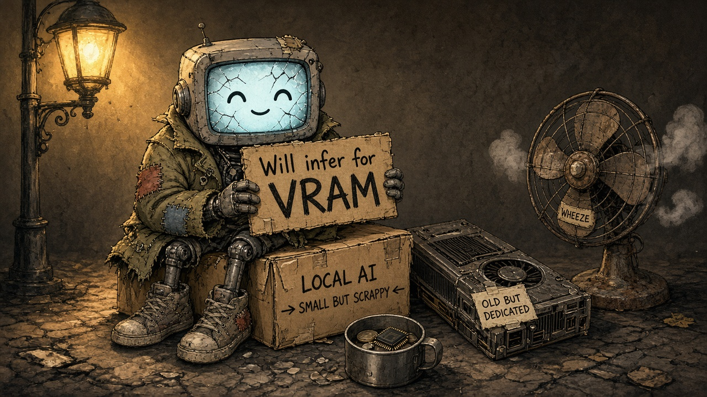

# Local AI Stack (Open WebUI + llama.cpp + Vulkan + Docling)



*Built for hardware that is small, scrappy, and a bit out of breath.*

Local LLM stack that runs **Open WebUI** in front of a **llama.cpp** server, with GPU acceleration through **Vulkan** on **Podman**, plus **[Docling Serve](https://github.com/docling-project/docling)** for document conversion and ingestion over HTTP. The compose file passes `/dev/dri` into the backend and selects `Vulkan0`, which matches an AMD GPU such as an RX 580.

## Contents

- `podman-compose.yml`: Podman Compose stack. Defines the llama.cpp backend, Open WebUI, Docling Serve, a shared bridge network (`local-ai_net`), and the three named volumes. Only Open WebUI publishes a port to the host (`3000`); the other services are reachable on that network by service name.
- `download-models.sh`: Interactive downloader. Pulls GGUF models from Hugging Face into the `local-ai_llama-models` volume.
- `run.sh`: Startup wrapper. Detects the host `video` and `render` group IDs, selects the model, and forwards arguments to `podman-compose`.
- `README.md`: How to use the stack.

## Services

| Service | Image | Host port | Role |
| --- | --- | --- | --- |
| `llama-backend` | `ghcr.io/ggml-org/llama.cpp:server-vulkan` | — (internal `8080`) | llama.cpp server with Vulkan offload (`-ngl 99`, device `Vulkan0`). Open WebUI reaches it at `http://llama-backend:8080/v1`. |
| `open-webui` | `ghcr.io/open-webui/open-webui:main` | `3000` | Chat UI. Only published service: `http://localhost:3000`. Backend URL set to `http://llama-backend:8080/v1`. |
| `docling-serve` | `quay.io/docling-project/docling-serve` | — (internal `5001`) | Docling Serve HTTP API for document processing; cache stored in a named volume. Other containers use `http://docling-serve:5001`. |

Persistent volumes:

- `local-ai_llama-models` stores the GGUF files, mounted at `/models` in the backend.
- `local-ai_open-webui-data` stores Open WebUI data.
- `local-ai_docling-cache` stores Docling and related caches (for example Hugging Face), mounted at `/root/.cache` in the Docling container.

`run.sh` reads the host `video` and `render` GIDs and passes them into the backend container so it can use the GPU. If a group is missing, it falls back to `44` (`video`) and `109` (`render`).

## Models

`download-models.sh` can fetch:

1. Qwen2.5-7B-Instruct (Q3_K_M, ~3.8GB)
2. Qwen2.5-Coder-7B-Instruct (Q4_K_M, ~4.7GB)
3. Llama-3.2-3B-Instruct (Q5_K_M, ~2.3GB)
4. All of the above

The default model, used when `MODEL_FILE` is unset, is `qwen2.5-coder-7b-instruct-q4_k_m.gguf`.

These weights are not part of this repository and are not covered by the MIT License below. Each model stays under the license of its publisher.

## Requirements

- Podman
- `podman-compose`
- A Vulkan-capable GPU exposed through `/dev/dri` (AMD, such as an RX 580)

## Usage

1. Make the scripts executable and download a model:

   ```bash
   chmod +x download-models.sh run.sh
   ./download-models.sh
   ```

   Choose an option from `1` to `5`. Option `4` downloads every model. Option `5` exits without downloading. Files land in the `local-ai_llama-models` volume.

2. Start the stack in the background:

   ```bash
   ./run.sh up -d
   ```

   With `-d`, `run.sh` launches `podman-compose` under `nohup`. Any other invocation is passed straight through, for example `./run.sh logs -f` or `./run.sh down`.

3. Start with a different model:

   ```bash
   MODEL_FILE=llama-3.2-3b-instruct-q5_k_m.gguf ./run.sh up -d
   ```

   `MODEL_FILE` must match a file already stored in `local-ai_llama-models`.

4. Open the UI at [http://localhost:3000](http://localhost:3000). That is the **only** host-facing port: llama.cpp and Docling are not published to the host. Open WebUI already talks to the LLM at `http://llama-backend:8080/v1` on the internal network. If you configure Docling in Open WebUI yourself, use **`http://docling-serve:5001`** (service name on the same network), not `http://localhost:5001`. For debugging, you can `podman exec` into a container, run a throwaway container on `container:open-webui`'s network, or temporarily add a `ports` mapping in the compose file.

## License

The [MIT License](LICENSE) covers only the code in this repository: `podman-compose.yml`, `download-models.sh`, `run.sh`, and this documentation. Copyright (c) 2026 Daniel de Matos Alves.

Model weights are not covered. `download-models.sh` only fetches GGUF files into a Podman volume. Those weights are not part of this repository and stay under the licenses of their original authors and distributors. The llama.cpp, Open WebUI, and Docling Serve container images are also outside this license.
